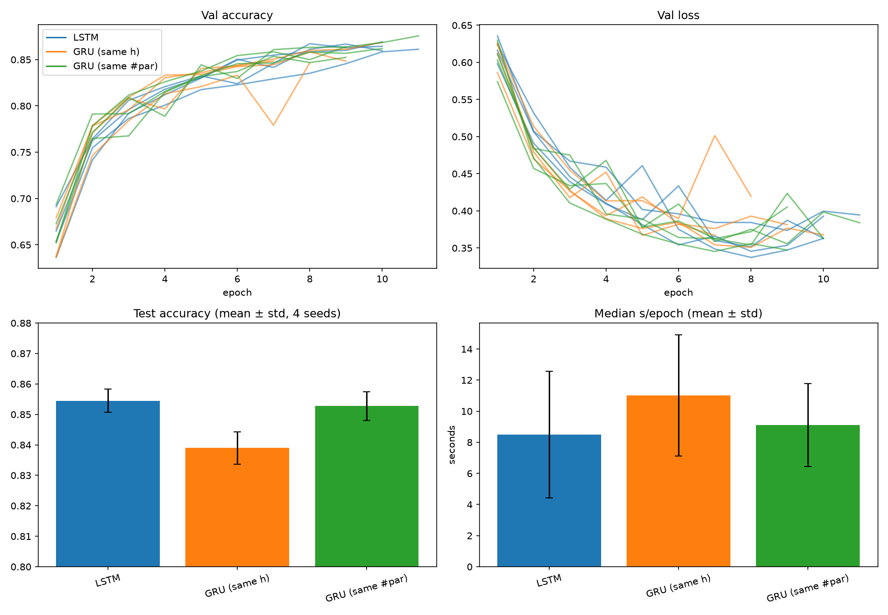

# LSTM vs GRU From Scratch: IMDB Sentiment Benchmark

This project compares two kinds of recurrent neural network layers, **LSTM** and **GRU**, on one task: deciding if an IMDB movie review is **positive or negative**.

Both layers are **written by hand in PyTorch** (no `nn.LSTM`, no `nn.GRU`), so every gate and every line of math is visible in the code.

The comparison looks at:

- **Accuracy** (how often the model is right)
- **Number of parameters** (how big the model is)
- **Speed** and **GPU memory**
- **How stable the results are** across different random seeds

---

## Short summary of the results

| Setup | Hidden size | Parameters | Test accuracy (mean over 4 seeds) |
|---|---|---|---|
| LSTM | 128 | 2,691,969 | **85.45%** |
| GRU, same hidden size | 128 | 2,659,457 | 83.90% |
| GRU, same number of parameters | 154 | 2,691,619 | **85.27%** |

- When the **model size is matched**, LSTM and GRU are equally accurate. The gap (0.2 points) is much smaller than the random difference between seeds (about 0.4 to 0.6 points).
- When only the **hidden size is matched**, the GRU is about 1.5 points lower. The reason is that it is a smaller model (3 gates instead of 4), not that it is a worse design.
- **Speed results are not reliable** in this run (explained in [Limitations](#limitations)), so no speed winner is declared.

---

## Table of contents

1. [Project layout](#project-layout)
2. [Setup](#setup)
3. [How to run](#how-to-run)
4. [What each file does](#what-each-file-does)
5. [The data (step by step)](#the-data-step-by-step)
6. [The models](#the-models)
7. [The experiment design](#the-experiment-design)
8. [Training details](#training-details)
9. [Results](#results)
10. [What the results mean](#what-the-results-mean)
11. [Limitations](#limitations)
12. [Reproducibility](#reproducibility)
13. [Simple glossary](#simple-glossary)
14. [Ideas for next steps](#ideas-for-next-steps)

---

## Project layout

```
DL/
├── data.py                 # builds the dataset, saves imdb_preprocessed.pt
├── models.py               # hand-written LSTM, GRU and the Classifier
├── train.py                # train_one_epoch() and evaluate()
├── bench.py                # runs all experiments, saves results.json
├── plot.py                 # draws comparison.png from results.json
├── imdb_preprocessed.pt    # made by data.py
├── results.json            # made by bench.py
└── comparison.png          # made by plot.py
```

Every `.py` file has simple comments that explain each step.

---

## Setup

Used for the reported results: Windows, a conda environment named `lstm-gru`, PyTorch with CUDA, and a laptop NVIDIA GPU.

Packages used by the code:

- `torch`
- `datasets` (Hugging Face, downloads IMDB)
- `numpy`
- `matplotlib`
- `scipy` (imported in `bench.py` but not used there)

```bash
conda activate lstm-gru
pip install torch datasets numpy matplotlib scipy
```

(Install the PyTorch build that matches your GPU/CUDA version.)

---

## How to run

Run the files in this order, from the project folder:

```bash
python data.py      # step 1: prepare the data  -> imdb_preprocessed.pt
python bench.py     # step 2: run experiments   -> results.json
python plot.py      # step 3: draw the graphs   -> comparison.png
```

### Options for `bench.py`

```bash
python bench.py --seeds 0                 # quick test with one seed
python bench.py --seeds 0 1 2 3           # all four seeds
python bench.py --deterministic           # repeatable GPU math (slower)
python bench.py --out results_final.json  # save to a different file
```

### Resume feature

`bench.py` saves `results.json` after **every** finished run. If the program stops or crashes, run it again and it **skips** the runs that are already saved.

> If you change any setting (learning rate, hidden size, epochs, etc.), **delete `results.json` first**. Otherwise old runs and new runs get mixed together.

### Tips for a fair benchmark

- Keep the laptop plugged in and use the performance power mode.
- Close other programs that use the GPU.

---

## What each file does

### `data.py` (prepares the data)

1. Downloads the IMDB dataset (25,000 train and 25,000 test reviews).
2. Splits off 10% of the train set as **validation** data (seed 42, so the split is always the same).
3. Cleans and splits each review into tokens (words).
4. Builds a vocabulary (word to number).
5. Makes every review exactly 256 numbers long.
6. Builds the data loaders and saves everything into `imdb_preprocessed.pt`.

### `models.py` (the networks)

- `LSTM`: a hand-written LSTM layer.
- `GRU`: a hand-written GRU layer.
- `Classifier`: the full model that turns a review into one score.

### `train.py` (training and checking)

- `train_one_epoch(...)`: one full pass over the training data. The model learns here.
- `evaluate(...)`: checks the model on validation or test data. The model does **not** learn here.

Both return `(average loss, accuracy)`.

### `bench.py` (the experiment)

Trains every setup for every seed, picks the best epoch for each, tests it once, and saves all numbers and per-epoch histories to `results.json`. It also prints a summary table.

### `plot.py` (the graphs)

Reads `results.json` and draws four graphs into `comparison.png`.

---

## The data (step by step)

| Step | What happens |
|---|---|
| Dataset | IMDB movie reviews, label 0 = negative, 1 = positive |
| Validation split | 10% of the train set (2,500 reviews), seed 42. The remaining 22,500 reviews are used for training |
| Test set | The official 25,000 test reviews. Used **once per run**, at the very end |
| Lowercase | "Good" and "good" become the same word |
| Remove HTML | Tags like `<br />` are removed |
| Tokenize | Keeps words and numbers (letters a-z, digits, apostrophes) and also keeps `!` and `?` as tokens |
| Vocabulary | Built from the **training data only**. Takes the 20,000 most common words, but only words seen at least 5 times. `<pad>` = 0 and `<unk>` = 1 are added, so the vocabulary has up to 20,002 entries |
| Unknown words | Any word not in the vocabulary becomes `<unk>` |
| Fixed length | Every review is exactly **256** tokens |
| Too long | Only the **last** 256 tokens are kept |
| Too short | `<pad>` is added at the **front** (left padding), so the real words end at the last position |
| Batches | 512 reviews per batch |

Why the vocabulary uses only train data: this way no information from the validation or test reviews leaks into the model.

Why left padding matters: the model uses only the **final** hidden state. With left padding, the final position is always a real word, so the model finishes "reading" on real text and not on padding.

---

## The models

### The full `Classifier`

```
review (256 numbers)
   -> Embedding (each word number becomes a 128-number vector)
   -> LSTM or GRU (reads the review one word at a time)
   -> take the FINAL hidden state
   -> Dropout (0.5)
   -> Linear layer -> ONE number (the score)
```

- Score **greater than 0** means "positive". Score **less than 0** means "negative".
- The embedding knows which number is padding (`padding_idx`), so the padding vector stays zero.

### LSTM (hand-written)

Has **4 gates**, all computed with one input layer and one hidden layer:

| Gate | Job |
|---|---|
| Input gate | How much new information to write into memory |
| Forget gate | How much of the old memory to keep |
| Output gate | How much of the memory to show as output |
| Candidate | The new information that could be written |

Steps at every word:

1. Forget part of the old memory.
2. Add the new candidate (scaled by the input gate).
3. New hidden state = tanh(memory) times the output gate.

The LSTM keeps **two** things: the hidden state and a separate memory (cell state).

### GRU (hand-written)

Has **3 pieces**: a reset gate, an update gate, and a candidate.

1. The reset gate decides how much old memory the candidate can see.
2. The update gate decides how much to replace the old state with the candidate.
3. New hidden state = (1 - update) times the old state, plus update times the candidate.

The GRU keeps only **one** thing: the hidden state. That is why it has fewer parameters at the same hidden size.

### Speed trick used in both cells

The input part of the math is computed for **all words at once** before the loop. Only the part that depends on the previous hidden state stays inside the loop.

### Where the parameters are

For hidden size 128, the **embedding layer is about 2.56 million** parameters. The LSTM or GRU layer itself is only about 100,000 to 130,000. So most of the model is the embedding, and the LSTM and GRU models differ by only about 1% in total size.

| Part | LSTM (h=128) | GRU (h=128) | GRU (h=154) |
|---|---|---|---|
| Embedding | 2,560,256 | 2,560,256 | 2,560,256 |
| Recurrent layer | 131,584 | 99,072 | 131,208 |
| Output layer | 129 | 129 | 155 |
| **Total** | **2,691,969** | **2,659,457** | **2,691,619** |

---

## The experiment design

Three setups are compared:

| Name in results | Cell | Hidden size | Why it is included |
|---|---|---|---|
| `LSTM` | LSTM | 128 | The baseline |
| `GRU (same h)` | GRU | 128 | Same width as the LSTM, but fewer parameters |
| `GRU (same #par)` | GRU | 154 | Hidden size chosen so the total parameters match the LSTM as closely as possible |

### Why two GRU versions?

A GRU with the same hidden size is a **smaller** model. If it scores lower, we cannot tell if it is because of the GRU design or just because it is smaller. The second GRU removes that doubt.

- **Same h** answers: "I have an LSTM model. What happens if I just swap in a GRU?"
- **Same #par** answers: "With the same size budget, which design works better?"

### How the matched hidden size is found

`bench.py` builds a GRU for every hidden size from 128 to 200, counts its parameters, and picks the size closest to the LSTM's count. This gave **154**. A warning is printed if the answer lands at the edge of the search range.

### Seeds

Each setup is run with seeds **0, 1, 2, 3**. A seed controls:

- the starting weights of the model
- the order in which the training data is shuffled

The train/validation split is **not** changed by the seed (it is fixed with seed 42).

---

## Training details

| Setting | Value |
|---|---|
| Optimizer | Adam |
| Learning rate | 0.001 |
| Loss | `BCEWithLogitsLoss` (yes/no loss that takes the raw score) |
| Embedding size | 128 |
| Hidden size | 128 (154 for the matched GRU) |
| Dropout | 0.5 (on the final hidden state) |
| Gradient clipping | 1.0 |
| Batch size | 512 |
| Review length | 256 tokens |
| Maximum epochs | 15 |
| Early stopping | Stop after 2 epochs in a row without improvement |
| Minimum improvement | 0.0001 |
| What decides "best epoch" | Lowest **validation loss** |

### What happens in one run

1. Set the seed and build a fresh model.
2. For each epoch: train, then check on validation data.
3. If validation loss improved, save a copy of the weights.
4. If there was no improvement twice in a row, stop (early stopping).
5. Load the **best** weights and test **once** on the test set.
6. Record all numbers.

### What is saved for every run

Parameters, best epoch, best validation loss and accuracy, test loss and accuracy, median seconds per epoch, samples per second, peak GPU memory, total time, and the full per-epoch history (loss, accuracy, validation loss, validation accuracy, epoch time).

### Structure of `results.json`

```
{
  "config":  { all settings used },
  "results": {
    "LSTM":            [ run for seed 0, seed 1, seed 2, seed 3 ],
    "GRU (same h)":    [ ... ],
    "GRU (same #par)": [ ... ]
  }
}
```

---

## Results



*Top row: validation accuracy and validation loss for every run. Bottom row: test accuracy and median seconds per epoch (bar = average, black line = spread over seeds).*

### Test accuracy (average over 4 seeds)

| Setup | Test accuracy | Spread (std) | Lowest to highest seed | Best epoch for each seed |
|---|---|---|---|---|
| LSTM (h=128) | 85.45% | 0.44 | 84.94 to 86.00 | 8, 8, 8, 9 |
| GRU same h (128) | 83.90% | 0.61 | 83.30 to 84.74 | 7, 8, 5, 6 |
| GRU same #par (154) | 85.27% | 0.55 | 84.90 to 86.09 | 9, 8, 7, 7 |

The spread in the table is the **sample** standard deviation (the same one `bench.py` prints). The error bars in the plot use the **population** standard deviation, so they look slightly smaller.

### Peak GPU memory

| Setup | Peak memory |
|---|---|
| LSTM (h=128) | about 883 to 924 MB |
| GRU same h (128) | about 881 to 922 MB |
| GRU same #par (154) | about 1,079 MB |

The wider GRU uses more memory even with the same parameter count, because the memory used during training grows with the hidden size.

### Speed (not reliable)

The median time per epoch ranged from about **5 s to 17 s**. The **same** model took very different times on different seeds. So the speed bars should **not** be used to say which cell is faster.

---

## What the results mean

1. **LSTM and GRU are equally good at the same model size.** 85.45% vs 85.27% is a tiny gap compared with the seed-to-seed spread.
2. **The lower score of the same-h GRU comes from its smaller size.** Making the GRU wider (154) closes the gap completely.
3. **All models overfit in a similar way.** Validation loss reaches its lowest point at about epoch 7 to 9, then goes up while training accuracy keeps rising. Early stopping handles this.
4. **Training is a little noisy.** One GRU (same h) run has a single bad validation epoch (accuracy dips, loss spikes) and then recovers.
5. **Four seeds can only show big differences.** The honest conclusion is "no difference was detected between LSTM and GRU at equal size", not "they are proven identical".

---

## Limitations

- **Speed numbers are noisy.** The hand-written cells loop over 256 words in Python, and every word launches many tiny GPU operations. The time is dominated by this launch overhead, and on a laptop GPU the clock speed and other programs change the timing a lot. A trustworthy speed test needs a separate benchmark: warm-up epoch, several timed epochs, nothing else running, alternating model order, and repeats.
- **Only 4 seeds.** Differences smaller than about one point cannot be separated from noise.
- **One dataset and one task.** IMDB sentiment is fairly easy, and most of the model is the embedding layer. The results may not carry over to tasks that need longer memory.
- **Reviews are cut to 256 tokens**, and only the **last** 256 are kept. Information at the start of long reviews is lost.
- **Same settings for every model.** No per-model tuning was done, which could favour one cell.
- **Single-layer, one-direction models.** No stacked or bidirectional versions were tested.
- **Not fully repeatable.** `deterministic` is off by default, so the same seed can give slightly different numbers on the GPU.
- **Gradient clipping happens twice.** `train_one_epoch` clips at 1.0 and `bench.py` adds another clip at 1.0 on the optimizer. The second one has no extra effect, but it is redundant.
- **Matching by parameters is one choice.** Matching by compute or by training time could give a different ranking.

---

## Reproducibility

- Seeds set Python, NumPy and PyTorch (CPU and GPU) random generators at the start of each run.
- The train/validation split is fixed (seed 42) and does not change with the experiment seed.
- Training data is shuffled with a seeded generator, so for the same seed every model sees the data in the same order.
- `results.json` stores the full settings next to the results.
- For the final reported numbers, run `python bench.py --deterministic`. It is slower, but it makes GPU math repeatable.
- Timing and tiny accuracy differences will change on different hardware.

---

## Simple glossary

| Word | Meaning |
|---|---|
| **Token** | One small piece of text, here a word or `!` / `?` |
| **Vocabulary** | The list that gives each known word its own number |
| **Embedding** | A learned list of numbers that represents a word |
| **Hidden state** | The "memory" the network carries from word to word |
| **Gate** | A number between 0 and 1 that decides how much information passes through |
| **Epoch** | One full pass over all the training data |
| **Batch** | A small group of reviews processed together |
| **Logit** | The raw score before it is turned into a yes/no answer |
| **Loss** | A number that says how wrong the model is (lower is better) |
| **Validation data** | Data used to choose the best epoch and stop early. The model does not learn from it |
| **Test data** | Data used once at the end for the final score |
| **Overfitting** | The model memorizes the training data and gets worse on new data |
| **Early stopping** | Stopping training when validation loss stops improving |
| **Dropout** | Randomly switching off some numbers during training to reduce overfitting |
| **Gradient clipping** | Limiting how big a weight update can get, for stable training |
| **Seed** | A number that fixes the random choices, so a run can be repeated |
| **Parameters** | The numbers inside the model that are learned |
| **Median** | The middle value; not thrown off by a few extreme values |
| **Standard deviation (std)** | How much the results differ from seed to seed |

---

## Ideas for next steps

- A clean **speed benchmark** (warm-up, repeated timing, fixed power settings).
- Add reference rows using the built-in `nn.LSTM` and `nn.GRU` to check that the hand-written cells match, and to see the speed difference.
- Run **more seeds** (10 or more) and add a significance test on test accuracy.
- Make the hand-written cells faster (larger batches, shorter reviews, `torch.compile`).
- Try different hidden sizes and review lengths.
- Try **bidirectional** or **multi-layer** versions.
- Test a task that needs longer memory.
